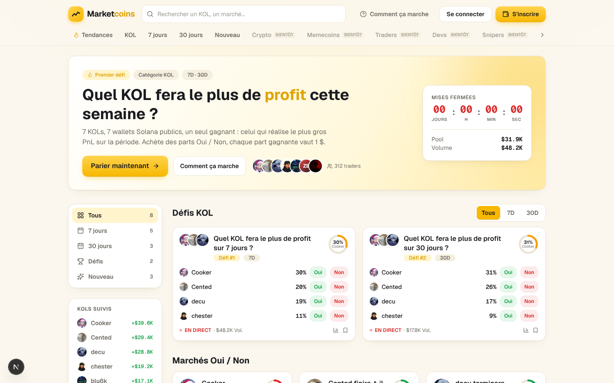
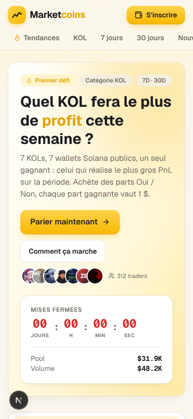

# DA Landing · Marketcoins

> Direction artistique de la landing (`/`), format « DA memescanner » : une intention, un mood, des specs
> exécutables section par section (logo, boutons, animations, scroll, clic), puis un backlog priorisé.
> Stack cible : Next 16 (App Router) · React 19 · Tailwind 4 · CSS natif. Aucune lib d'animation obligatoire.

---

## 0. TL;DR

| | |
|---|---|
| **Pitch visuel** | *« Le scanner des KOLs. »* Un terminal de trading chaleureux : fond crème, or signal, chiffres mono qui vivent. |
| **Mot d'ordre** | **Vivant.** Tout ce qui est un chiffre bouge, tout ce qui est « en direct » respire. Zéro écran mort. |
| **Ce qu'on garde** | Crème + or + encre, Geist / Geist Mono, cartes arrondies, hiérarchie Oui / Non vert / rouge. |
| **Ce qu'on ajoute** | Un **hero « scanner »** (panneau encre sombre dans la page crème), un **ticker live**, un système de motion unifié (tokens, reveal au scroll, number roll, flash de prix), un logo animé. |
| **Ce qu'on corrige** | Chrono mort à `00:00:00:00` sur le hero, « EN DIRECT » en rouge (= couleur de la perte), pas de section « comment ça marche » ni de preuve sociale sur la landing. |

---

## 1. Intention

Memescanner, Polymarket, les dashboards Solana : le code visuel du « degen sérieux » c'est
**data dense + réactivité immédiate + une touche de jeu**. Marketcoins a déjà la base propre
(crème / or, façon Polymarket). Ce qui manque c'est l'**adrénaline** : la page est belle mais statique,
elle ne donne pas l'impression que des wallets gagnent ou perdent de l'argent *en ce moment*.

La DA tient en trois principes :

1. **Scanner, pas brochure.** La landing *montre* le marché en train de tourner (PnL qui bouge, cotes qui
   clignotent, chrono qui défile) plutôt que de l'expliquer.
2. **Or = signal, pas décoration.** L'or n'est utilisé que pour ce qui mérite un clic ou un regard :
   CTA principal, leader du classement, pill « en vedette ». Partout ailleurs : encre, crème, gris.
3. **Motion avec un sens.** Chaque animation répond à une question (« ça vient d'où ? », « ça a marché ? »,
   « c'est en direct ? »). Pas d'animation « pour faire joli ».

**Références de ton** : terminal Bloomberg (densité), Polymarket (clarté des cotes), memescanner / pump
dashboards (ticker, flashs vert/rouge, radar), Linear / Vercel (motion sobre, easing précis).

---

## 2. État actuel (captures)

Captures de la branche actuelle, données mock, viewport 1440 × 900 et 390 × 844.

| Desktop · above the fold | Mobile · above the fold |
|---|---|
|  |  |

Pages complètes : [`da/landing-desktop-full.png`](./da/landing-desktop-full.png) · [`da/landing-mobile-full.png`](./da/landing-mobile-full.png).

### Diagnostic

**Ce qui marche**
- Palette crème / or / encre lisible, cohérente, déjà tokenisée dans `globals.css`.
- Cartes marché : densité correcte, avatars empilés, jauge circulaire du leader, boutons Oui / Non inline.
- Primitives CSS solides (`btn`, `pill`, `card`, `seg`, `stagger`, `fade-up`, `draw-line`).
- Nav sticky avec blur, catégories « bientôt » qui annoncent la roadmap.

**Ce qui bloque**
- **Le hero est mort** : chrono à `00:00:00:00` + « Mises fermées » en rouge, premier élément lu après le titre.
  Un visiteur comprend « c'est fini ». Voir §9 P0.
- **« EN DIRECT » est rouge** (`text-down`). Rouge = perte dans tout le reste de l'UI. Le live doit être vert (ou or).
- **Rien ne bouge après le chargement** : pas de PnL live, pas de ticker, pas de hover qui raconte quelque chose.
- Aucune section « comment ça marche », aucune preuve sociale (volume total, nb de traders, derniers trades) sur la landing.
- Sur mobile, le bloc chrono / pool arrive après deux CTA et les avatars : la hiérarchie est inversée (le chrono devrait être *dans* le hero, en haut).
- Le logo est un simple carré or + courbe : correct mais générique, et pas animé.

---

## 3. Identité visuelle

### 3.1 Palette

On garde les tokens existants et on en ajoute trois pour le « mode scanner » (panneaux sombres dans la page claire).

| Token | Valeur | Rôle |
|---|---|---|
| `--color-cream` | `#fbf7ee` | Fond de page |
| `--color-cream-2` | `#f5efe0` | Fond secondaire, hover léger |
| `--color-ink` | `#1b1b1f` | Texte, bouton sombre |
| `--color-muted` | `#6f6b63` | Texte secondaire |
| `--color-line` | `#ebe4d3` | Bordures |
| `--color-gold` / `-2` / `-3` | `#f7b801` / `#ffd34d` / `#e0a400` | **Signal** : CTA, leader, vedette |
| `--color-up` / `-soft` | `#16a34a` / `#e6f7eb` | Oui, gain, live |
| `--color-down` / `-soft` | `#dc2626` / `#fdeaea` | Non, perte, fermé |
| **`--color-panel`** *(nouveau)* | `#121216` | Fond des panneaux « scanner » (hero, ticker) |
| **`--color-panel-2`** *(nouveau)* | `#1c1c22` | Cartes à l'intérieur d'un panneau sombre |
| **`--color-panel-line`** *(nouveau)* | `rgba(255,255,255,.08)` | Bordures sur fond sombre |

Règles :
- Sur fond sombre, l'or passe en `gold-2` (`#ffd34d`) pour le texte et garde `gold` pour les fonds.
- Le vert / rouge sur fond sombre : `#22c55e` / `#ef4444` (une marche plus claire) pour rester lisibles.
- **Jamais plus d'un élément or « plein » par viewport** (hors pills). Si deux CTA sont visibles, le second est ghost.
- Les glows (`blur-3xl` or) restent derrière les panneaux sombres uniquement : sur crème ils salissent.

### 3.2 Typographie

- **Geist** pour tout le texte. Titres `font-bold tracking-tight`, H1 `text-4xl md:text-5xl`, H2 `text-xl`.
- **Geist Mono** (`.mono`, `tabular-nums`) pour **tout ce qui est un nombre** : prix, %, PnL, chrono, adresses.
  Règle absolue : un chiffre qui peut changer est en mono, sinon il « saute » quand il s'anime.
- Micro-labels : `text-[10px] uppercase tracking-wider font-semibold text-muted` (déjà en place sur le chrono).
- Sur panneau sombre : titres en crème `#fbf7ee`, texte secondaire `rgba(251,247,238,.6)`.

### 3.3 Formes, ombres, grille

- Radius : `rounded-2xl` cartes, `rounded-xl` boutons / inputs, `rounded-full` pills / avatars. Pas d'autre valeur.
- Ombres : celles de `.card` et `.card-hover`. Sur panneau sombre : pas d'ombre, une bordure `panel-line` + un glow or à 10 %.
- Grille : conteneur `max-w-6xl`, gouttière 16 px mobile / 24 px desktop, `gap-4` dans les grilles de cartes.
- Icônes : `lucide-react`, `size 14-16`, stroke par défaut. Pas d'emoji dans l'UI (ok dans les pills « 🔥 » ? **non**, on utilise `Flame`).

### 3.4 Texture « scanner »

Deux motifs discrets, **uniquement** sur les panneaux sombres :
- **Grille** : `background-image: linear-gradient(rgba(255,255,255,.04) 1px, transparent 1px), linear-gradient(90deg, …)` en `24px 24px`.
- **Balayage radar** : un dégradé conique or à 8 % qui tourne lentement derrière le chrono (`@keyframes sweep`, 6 s, linéaire). Désactivé en `prefers-reduced-motion`.

---

## 4. Logo

### 4.1 Lecture de l'existant

Carré or dégradé (`#ffd34d → #f7b801`), ombre or, pictogramme « courbe qui monte » + point, wordmark
**Market**<span style="color:#e0a400">coins</span>. Points forts : lisible à 24 px, mémorisable, l'or signe la marque.
Points faibles : le picto est un chart générique (= 50 % des apps crypto), aucune animation, pas de version monochrome.

### 4.2 Évolution proposée (itération, pas refonte)

- **Picto** : on garde la courbe mais on la transforme en **ligne de scan** : la courbe se termine par un point
  qui pulse (le « live ») et le tracé est légèrement plus anguleux (3 segments, angles nets) pour évoquer un
  PnL on-chain plutôt qu'une courbe boursière lisse.
- **Carré** : coins `rounded-xl` conservés, dégradé conservé. Variante « panel » : carré encre avec picto or (pour les fonds sombres).
- **Wordmark** : `Market` encre, `coins` or-3. Sur fond sombre : `Market` crème, `coins` gold-2.
- **Monogramme** : le picto seul dans le carré (favicon, avatar X, app icon). À exporter en 16 / 32 / 180 / 512 px.

### 4.3 Animation du logo

| Moment | Animation | Durée |
|---|---|---|
| Chargement de la page (1 fois par session) | La courbe se **dessine** (`stroke-dasharray` / `draw-line` déjà existante), puis le point **pop** (`scale 0 → 1.2 → 1`) | 600 ms + 200 ms |
| Hover sur le logo | Le carré tourne de `-4deg` et l'ombre or s'intensifie ; le point pulse une fois | 200 ms |
| État « live » (données fraîches < 60 s) | Le point du picto adopte `.live-dot` (pulse 1.6 s) | boucle |
| Clic | `active:scale-[0.96]` | 100 ms |

Implémentation : passer `Logo` en composant avec une prop `animate?: boolean`, le `<path>` reçoit `className="draw-line"`
et `pathLength="1"` (dasharray `1`, dashoffset `1`), le `<circle>` reçoit `.pop` avec `animation-delay: .6s`.
La « 1 fois par session » se gère avec `sessionStorage.getItem("logo-played")` dans un `useEffect`.

### 4.4 Zone de protection et interdits

- Marge minimale autour du logo = hauteur du carré ÷ 2.
- Jamais le wordmark sans le carré en dessous de 120 px de large ; jamais d'ombre portée sur le wordmark.
- Jamais l'or sur fond or ; sur photo / fond chargé, utiliser la variante « panel ».

---

## 5. La landing, section par section

Ordre de scroll cible (desktop et mobile identique, seule la grille change) :

```
┌─────────────────────────────────────────────────────────┐
│ 1. NAV sticky (logo · recherche · CTA)                   │
│ 2. TICKER live (bande fine, défilement continu)          │
├─────────────────────────────────────────────────────────┤
│ 3. HERO « scanner »  (panneau encre)                     │
│    titre · sous-titre · CTA or + ghost                   │
│    [course PnL live 7 KOLs]   [chrono · pool · volume]   │
├─────────────────────────────────────────────────────────┤
│ 4. PREUVE : 4 compteurs (volume · traders · KOLs · payé) │
├─────────────────────────────────────────────────────────┤
│ 5. DÉFIS KOL  (sidebar filtres | grille cartes)          │
│ 6. MARCHÉS OUI / NON                                     │
├─────────────────────────────────────────────────────────┤
│ 7. COMMENT ÇA MARCHE  (3 étapes, scroll-reveal)          │
│ 8. ACTIVITÉ RÉCENTE  (derniers trades, flux)             │
│ 9. CTA final + FOOTER                                    │
└─────────────────────────────────────────────────────────┘
```

### 5.1 Nav

- Inchangée structurellement. Ajouts :
  - Le fond passe de `bg-cream/85` à `bg-cream/70` + `backdrop-blur-xl` quand on a scrollé > 8 px, et la bordure basse apparaît (transition 200 ms). Avant scroll : pas de bordure, nav « fondue » dans la page.
  - Le CTA « S'inscrire » devient **« Parier »** une fois connecté (verbe d'action, pas d'étape administrative).
  - Les catégories « bientôt » : opacité 50 %, `cursor: not-allowed`, et au hover une tooltip `Bientôt · Q1 2027` (pas un lien qui ne mène nulle part).
- Barre de recherche : focus → `ring-4 ring-gold/20` (existant) + le placeholder défile 3 suggestions (« Cooker », « Top KOL 30 jours », « Memecoins ») toutes les 3 s, en `fade-up`. Désactivé en reduced motion.

### 5.2 Ticker live (nouveau)

Bande de 32 px sous la nav, fond `panel`, texte mono 12 px crème.
Contenu : `COOKER +$39.6K ▲ · CENTED +$29.4K ▲ · DECU +$28.8K ▲ · … · POOL $31.9K · 312 TRADERS`.
- Défilement continu `translateX(0 → -50%)` sur un contenu dupliqué, `40 s linear infinite`, **pause au hover**.
- Chaque PnL est coloré up / down ; quand une valeur change, elle **flashe** (§7.4).
- Mobile : vitesse 25 s, police 11 px. Reduced motion : la bande devient statique et scrollable horizontalement.

### 5.3 Hero « scanner »

Le changement principal de la DA. Le hero devient un **panneau encre** (`--color-panel`) dans la page crème :
c'est là que la marque bascule du « site vitrine » au « terminal ». Tout le reste de la page reste clair.

```
┌───────────────────────────────────────────────────────────────┐ panel #121216, grille 24px
│ ● EN DIRECT   Défi #1 · 7 jours                                │ pill verte, dot pulse
│                                                                 │
│ Quel KOL fera le plus de PROFIT          ┌───────────────────┐ │
│ cette semaine ?                          │ FIN DU DÉFI DANS   │ │ chrono mono gold-2
│                                          │ 04 : 12 : 37 : 09  │ │ flip par chiffre
│ 7 wallets publics. Un gagnant.           │ ───────────────── │ │
│ Chaque part gagnante vaut 1 $.           │ Pool    $31.9K     │ │ number roll
│                                          │ Volume  $48.2K     │ │
│ [ Parier maintenant → ]  [ Comment ça marche ]                 │
│                                                                 │
│ ┌─ course PnL (7 lignes) ───────────────────────────────────┐  │ barres horizontales
│ │ 1 ● Cooker   ███████████████████  +$39.6K  30%  [Oui][Non]│  │ qui grandissent au load
│ │ 2 ● Cented   █████████████        +$29.4K  20%            │  │ leader = barre or
│ │ … │                                                       │  │
│ └───────────────────────────────────────────────────────────┘  │
└───────────────────────────────────────────────────────────────┘
```

- **Titre** : H1 crème, `profit` en gold-2. Entrée : chaque mot en `fade-up` décalé de 40 ms (split par `<span>`), total < 500 ms.
- **Chrono** : mono 32 px gold-2, label **« Fin du défi dans »** (ou « Ouverture dans » si pas lancé). Chaque chiffre change par **flip vertical** (§7.5). Si le défi est fermé : label « Défi terminé », chiffres gris, et le **CTA devient « Voir les résultats »**. Un hero ne montre jamais `00:00:00:00` rouge.
- **Course PnL** : 7 lignes, barre proportionnelle au PnL du leader. Au chargement les barres grandissent `scaleX(0 → 1)` origin left, 700 ms, stagger 60 ms. Le leader a la barre or + un `Trophy` 12 px. Hover sur une ligne : fond `panel-2`, boutons Oui / Non apparaissent (sur mobile ils sont toujours visibles).
- **Avatars empilés + « 312 traders »** passent sous les CTA, à gauche, en crème 60 %.
- **Fond** : grille 24 px + balayage radar derrière le bloc chrono + glow or `blur-3xl` 20 % en haut à droite.
- Mobile : le bloc chrono passe **en premier** sous les pills, la course PnL montre 4 lignes + « Voir les 7 ».

### 5.4 Preuve sociale : 4 compteurs

Bande crème juste sous le hero, 4 colonnes (`2x2` mobile) :
`$48.2K volume · 312 traders · 7 KOLs suivis · $12.4K payés`.
Chiffres mono 28 px encre, label muted. **Count-up** au premier passage dans le viewport (§7.3), 900 ms, easing out.

### 5.5 Défis KOL (grille existante)

- Garde la structure sidebar + grille. Ajouts :
  - `.stagger` remplacé par un **reveal au scroll** (§7.2) : les cartes n'animent que quand elles entrent dans l'écran.
  - Jauge circulaire du leader : le trait se dessine (`stroke-dashoffset`) au reveal, 600 ms.
  - Hover carte : existant (`translateY(-2px)`) + la bordure devient `#f3d98a` + **le titre reste encre** (le passage en or-3 au hover fait trop d'or avec les pills). L'or va sur la jauge qui s'épaissit de `3.5 → 4.5`.
  - Les mini-boutons Oui / Non dans la liste deviennent de **vrais boutons** (aujourd'hui des `<span>`) : clic → ouvre le TradePanel pré-rempli, sans naviguer. `e.preventDefault()` sur le `Link` parent.
  - « EN DIRECT » : dot + texte **vert** (`text-up`), pas rouge.
- Sidebar : l'item actif a une barre or de 3 px à gauche qui **glisse** entre les items (`layout` transition via `view-transition-name` ou un pseudo-élément positionné), 250 ms.

### 5.6 Marchés Oui / Non

- Mêmes règles que 5.5. Les boutons `Oui 62¢` / `Non 38¢` : la largeur de chaque bouton est **proportionnelle à la cote** (grid `62fr 38fr`) : on lit le marché sans lire le chiffre. Transition de largeur 400 ms quand la cote bouge.

### 5.7 Comment ça marche (nouveau sur la landing)

3 cartes en ligne (colonne sur mobile), fond blanc, numérotées `01 02 03` en mono or :
1. **Choisis un KOL** (icône `Users`) · 2. **Achète Oui ou Non** (icône `ArrowRight`) · 3. **Chaque part gagnante vaut 1 $** (icône `Trophy`).
Reveal au scroll avec stagger 120 ms. Une ligne pointillée relie les 3 cartes sur desktop et se dessine (`draw-line`) quand la section est visible. Lien « Tout comprendre → » vers `/comment-ca-marche`.

### 5.8 Activité récente (nouveau)

Liste de 8 derniers trades (`Avatar · 0x4f…a2 a acheté Oui Cooker · $120 · il y a 12 s`).
Un nouveau trade **s'insère en haut** : hauteur `0 → 40px` + `fade-up`, 300 ms, les autres glissent vers le bas
(transition sur `transform`, pas sur `top`). Max 8 lignes, la dernière sort en fade. Données mock : un `setInterval` 6-12 s aléatoire alimenté par `data.ts` ; données réelles : Supabase Realtime sur `trades`.

### 5.9 CTA final + Footer

Bloc crème-2, titre « Prêt à parier sur le prochain top KOL ? », CTA or + ghost. Footer existant inchangé,
le logo du footer en taille 24 sans animation.

---

## 6. Boutons : UX / UI

### 6.1 Hiérarchie

| Classe | Usage | Règle |
|---|---|---|
| `btn-gold` | **Une** action principale par vue (Parier, Déposer, Confirmer) | Jamais deux visibles côte à côte |
| `btn-dark` | Action principale sur fond or ou dans une modale | Remplace `btn-gold` quand le fond est déjà or |
| `btn-ghost` | Secondaire (Comment ça marche, Annuler, Se connecter) | Toujours à droite ou après le principal |
| `btn-up` / `btn-down` | Prise de position Oui / Non | Toujours par paire, Oui à gauche |
| `btn-panel` *(nouveau)* | Ghost sur fond sombre : bordure `panel-line`, texte crème, hover `bg-white/8` | Hero, ticker |

Tailles : `sm` (h-7, text-xs, px-2.5 : inline dans les listes), `md` (h-10, text-sm : défaut), `lg` (h-12, text-base, px-5 : hero et modales). Largeur pleine (`w-full`) uniquement sur mobile dans les modales et le TradePanel.

### 6.2 États (obligatoires sur chaque bouton)

| État | Spec |
|---|---|
| Default | Voir classes. Texte `font-semibold`, icône 16 px à droite pour « aller vers », à gauche pour « faire ». |
| Hover | `btn-gold` : `brightness(1.04)` + ombre or étendue + **translateY(-1px)**. Ghost : `bg-cream-2`. Up / Down : fond plein + texte blanc (existant). Durée 150 ms. |
| Active (press) | `scale(0.98)` **et** `translateY(0)` (annule le hover), 80 ms. C'est le « clic » physique. |
| Focus visible | `outline: 2px solid var(--color-gold-3); outline-offset: 2px` (jamais `outline: none` seul). Sur fond sombre : `gold-2`. |
| Loading | Texte remplacé par un spinner 16 px + label `aria-busy`. Largeur **figée** (`min-width` = largeur avant) pour éviter le saut. Après 400 ms minimum (pas de flash de spinner). |
| Success | Fond passe en `up`, icône `Check` qui **pop**, 1 200 ms, puis retour. Utilisé après un trade / un dépôt. |
| Disabled | `opacity-50 cursor-not-allowed`, pas de hover. Un bouton disabled a **toujours** une raison visible à côté (« Connecte ton wallet »). |

### 6.3 Micro-interactions spécifiques

- **CTA « Parier maintenant »** (hero) : la flèche `ArrowRight` glisse de `+3px` au hover (`transition-transform`). Toutes les 8 s, sans hover, un **reflet** traverse le bouton (gradient blanc 30 % en `translateX(-100% → 200%)`, 900 ms) : c'est le seul bouton autorisé à s'animer seul, et uniquement dans le hero.
- **Oui / Non** : au clic, le bouton **pulse** une fois (`scale 1 → 1.06 → 1`, 250 ms) et le TradePanel s'ouvre en `pop`. Le montant par défaut est pré-rempli (`$10`) et le bouton de confirmation affiche le gain potentiel en mono (`→ $16.10 si Oui`).
- **Confirmer un trade** : état loading ≥ 400 ms → success (fond vert, `Check`) → la position apparaît dans « Activité récente » avec l'insertion animée (§5.8). Pas de confettis : un **flash vert** sur le solde dans la nav (§7.4) suffit.
- **Copier une adresse** (`CopyButton`) : l'icône `Copy` → `Check` vert 1 500 ms, texte « Copié ». Existant à aligner sur ces durées.
- **Seg 7D / 30D** : l'onglet actif est un fond or qui **glisse** (pseudo-élément `translateX`, 200 ms) plutôt qu'un bg qui saute.

### 6.4 Accessibilité boutons

- Zone de clic ≥ 40 × 40 px (les mini Oui / Non `h-7` passent à `h-8` + `px-3` sur mobile).
- `aria-pressed` sur les segments, `aria-label` sur les boutons icône (`Bookmark`, `BarChart3`).
- Jamais une couleur seule pour porter le sens : Oui / Non ont toujours leur texte, up / down un `▲ ▼` ou un signe `+ -`.

---

## 7. Système d'animation

### 7.1 Tokens de motion (à ajouter dans `globals.css`)

```css
@theme inline {
  --ease-out:   cubic-bezier(0.2, 0.7, 0.2, 1);   /* entrées, reveal (existant) */
  --ease-in-out: cubic-bezier(0.4, 0, 0.2, 1);    /* déplacements, draw */
  --ease-spring: cubic-bezier(0.34, 1.56, 0.64, 1); /* pop, succès (léger overshoot) */
  --dur-fast: 120ms;   /* press, hover, flash */
  --dur-base: 250ms;   /* pop, seg, tabs */
  --dur-slow: 450ms;   /* fade-up, reveal */
  --dur-draw: 900ms;   /* barres, jauges, lignes, count-up */
}
```

Règles :
- **Entrée** = `ease-out`, **sortie** = plus courte que l'entrée (× 0,6), **boucle** = `linear` ou `ease-in-out`.
- Rien ne dépasse 900 ms sauf les boucles (ticker, radar, float).
- On anime **uniquement** `transform`, `opacity`, `stroke-dashoffset`, `background-position`, `filter`. Jamais `width` / `height` / `top` (sauf §5.8 via `grid-template-rows` ou `max-height` sur un seul élément).
- Un élément ne porte qu'une animation d'entrée. Pas de `fade-up` + `pop` sur le même nœud.

### 7.2 Scroll : reveal

Remplacer `.stagger` (qui anime au mount même hors écran) par un reveal piloté par le viewport. Deux options, la **première par défaut** (zéro JS) :

**Option A : scroll-driven animations CSS** (Chrome / Edge / Safari 26+ ; fallback = visible immédiatement)

```css
@supports (animation-timeline: view()) {
  .reveal {
    animation: fade-up var(--dur-slow) var(--ease-out) both;
    animation-timeline: view();
    animation-range: entry 0% entry 30%;
  }
  .reveal-stagger > * { animation-timeline: view(); animation-range: entry 0% entry 35%; }
}
```

**Option B : hook `useReveal`** (IntersectionObserver, nécessaire pour les count-up et les jauges) :

```tsx
"use client";
import { useEffect, useRef, useState } from "react";
export function useReveal<T extends HTMLElement>(threshold = 0.25) {
  const ref = useRef<T>(null);
  const [seen, setSeen] = useState(false);
  useEffect(() => {
    const el = ref.current; if (!el) return;
    const io = new IntersectionObserver(([e]) => { if (e.isIntersecting) { setSeen(true); io.disconnect(); } }, { threshold });
    io.observe(el); return () => io.disconnect();
  }, [threshold]);
  return { ref, seen };
}
// <section ref={ref} data-seen={seen}> … [data-seen="true"] .bar { animation: grow … }
```

Comportement : seuil 25 %, **une seule fois** (pas de re-animation en remontant), décalage 60 ms entre enfants (max 8 enfants animés, les suivants sont visibles directement).

### 7.3 Scroll : count-up et parallaxe

- **Count-up** (compteurs §5.4, pool, volume) : composant `<CountUp to={48200} format={usd} />` qui interpole sur 900 ms `ease-out` avec `requestAnimationFrame`, déclenché par `useReveal`. Toujours en `.mono` pour que la largeur soit stable. Démarre à 0 pour les compteurs de preuve, à la **valeur précédente** pour les mises à jour live.
- **Parallaxe** : **une seule** couche, le glow or du hero, `translateY(scrollY * -0.15)` via `animation-timeline: scroll()` (CSS) ; sinon rien. Pas de parallaxe sur du texte ni sur les cartes.
- **Nav** : classe `is-scrolled` posée par un `useEffect` sur `scrollY > 8` (ou `scroll-timeline` CSS) : bordure + blur renforcé.
- **Ancres** : `html { scroll-behavior: smooth; }` + `scroll-margin-top: 96px` sur les sections (hauteur nav + ticker).

### 7.4 Données live : number roll et flash

Le cœur de l'effet « scanner ».

- **Flash** : quand une valeur numérique change, son conteneur reçoit `data-flash="up" | "down"` pendant 600 ms :
  ```css
  [data-flash="up"]   { animation: flash-up   600ms var(--ease-out); }
  [data-flash="down"] { animation: flash-down 600ms var(--ease-out); }
  @keyframes flash-up   { 0% { background: rgba(22,163,74,.25); } 100% { background: transparent; } }
  @keyframes flash-down { 0% { background: rgba(220,38,38,.25); } 100% { background: transparent; } }
  ```
  Composant `<LiveNumber value={…} />` : compare `prev` / `value` dans un `useEffect`, pose l'attribut, le retire sur `animationend`.
- **Number roll** (chiffre qui « tourne » comme un compteur) : pour les % de cotes et le solde. Chaque chiffre est une colonne `overflow-hidden` de hauteur `1em` contenant `0-9` empilés, `translateY(-digit * 1em)` avec `transition var(--dur-draw) var(--ease-in-out)`. Fallback reduced motion : remplacement direct.
- **Barres** (course PnL, Oui / Non proportionnels) : `transform: scaleX()` avec `transform-origin: left`, 400 ms, jamais `width`.
- **Jauges circulaires** : `stroke-dashoffset` en transition 600 ms.

### 7.5 Chrono : flip

Chaque chiffre du chrono est une cellule `relative overflow-hidden h-[1em]`. Au changement, l'ancien chiffre
sort vers le haut (`translateY(-100%)`, opacité 0) pendant que le nouveau entre par le bas (`translateY(100% → 0)`), 250 ms `ease-out`.
Implémentation : garder `prev` et `value` dans le composant `Cell`, rendre les deux `<span>` avec une `key` différente, animation CSS `slide-out-up` / `slide-in-up`. Les secondes seules flippent chaque seconde ; les autres cellules n'animent que quand elles changent.
Quand il reste **moins d'une heure**, le chrono passe en `down` et le dot « EN DIRECT » pulse 2 × plus vite.

### 7.6 Clic et transitions de page

- **Press** : `active:scale-[0.98]` partout (existant) + `active:translate-y-0`.
- **Ouverture de modale / TradePanel** : overlay `opacity 0 → 1` 200 ms, panneau `.pop` (scale 0.96 → 1), fermeture 150 ms. Sur mobile, le TradePanel est un **bottom sheet** : `translateY(100% → 0)` 300 ms `ease-out`.
- **Navigation vers une page marché** : composant `<ViewTransition>` de React 19.3, supporté par l'App Router **sans configuration** (guide : `node_modules/next/dist/docs/01-app/02-guides/view-transitions.md`). On enveloppe le titre + avatars de `MarketCard` et le header de `MarketView` dans `<ViewTransition name={`market-${slug}`}>` → ils **morphent** vers leur nouvelle place, 300 ms, durée et easing réglés en CSS via `::view-transition-group(*)`. Sans support navigateur : navigation classique, et on garde `fade-up` sur la page.
- **Hover sur une carte** : `translateY(-2px)` (existant). Pas de tilt 3D, pas de spotlight qui suit la souris : trop « landing SaaS », pas « terminal ».

### 7.7 Chargement et skeletons

- Toute donnée asynchrone a un skeleton de **même hauteur** que le contenu final (pas de saut de layout). Skeleton = `bg-cream-2` + `shimmer` (existant), 1,4 s.
- `loading.tsx` dans `app/` avec le squelette du hero + 4 cartes.
- Les avatars KOL ont un `bg` = `kol.color` à 20 % en attendant l'image (`placeholder` CSS).

### 7.8 Reduced motion et performance

- Étendre la media query existante : toutes les boucles (`ticker`, `sweep`, `float`, `live-dot`, reflet CTA) **off** ; les reveals deviennent instantanés ; les flashs restent (ils portent de l'information), mais sans mouvement.
- Budget : aucune animation JS en dehors de `CountUp` et `LiveNumber` ; les deux utilisent `requestAnimationFrame` et s'arrêtent quand `document.hidden`.
- Pas de `will-change` global : uniquement sur le ticker et les barres.
- Lighthouse cible mobile : LCP < 2 s (hero = HTML + CSS, pas d'image lourde), CLS = 0, INP < 200 ms.

---

## 8. Composants à créer / modifier

| Fichier | Action |
|---|---|
| `src/app/globals.css` | Tokens motion (§7.1), `--color-panel*`, `.btn-panel`, `.reveal`, `flash-*`, `sweep`, `slide-*-up`, extension reduced-motion |
| `src/components/Logo.tsx` | Prop `animate`, path `draw-line`, dot `.pop`, variante `tone="panel"` |
| `src/components/Hero.tsx` *(nouveau)* | Panneau sombre, titre split, chrono, course PnL (extrait de `page.tsx`) |
| `src/components/Ticker.tsx` *(nouveau)* | Bande live défilante |
| `src/components/Stats.tsx` *(nouveau)* | 4 compteurs + `CountUp` |
| `src/components/HowItWorks.tsx` *(nouveau)* | 3 étapes + ligne pointillée |
| `src/components/ActivityFeed.tsx` *(nouveau)* | Derniers trades, insertion animée |
| `src/components/live/CountUp.tsx`, `LiveNumber.tsx`, `NumberRoll.tsx` *(nouveaux)* | Primitives data live |
| `src/components/Countdown.tsx` | Flip par cellule, état fermé → « Défi terminé », label « Fin du défi dans » |
| `src/components/MarketCard.tsx`, `BinaryCard.tsx` | Oui / Non en vrais boutons, « EN DIRECT » vert, jauge animée au reveal, largeur Oui / Non proportionnelle |
| `src/components/Nav.tsx` | État scrolled, CTA « Parier » si connecté, tooltip « bientôt » |
| `src/lib/useReveal.ts` *(nouveau)* | Hook IntersectionObserver |
| `src/app/loading.tsx` *(nouveau)* | Skeleton landing |
| `src/app/page.tsx` | Assemblage des sections dans l'ordre §5 |

Aucune dépendance supplémentaire. Si une animation de layout complexe devient nécessaire (réordonnancement
animé de la course PnL quand le classement change), ajouter **`motion`** (`motion/react`, `LayoutGroup` + `layout`)
et rien d'autre.

---

## 9. Backlog priorisé

**P0 : la landing ne doit plus avoir l'air morte (1 à 2 jours)**
1. Chrono : label « Fin du défi dans », état fermé propre, CTA adapté, flip des chiffres.
2. « EN DIRECT » en vert partout.
3. Hero « scanner » (panneau encre, course PnL avec barres animées, chrono + pool / volume).
4. Tokens motion + reveal au scroll à la place de `.stagger`.
5. Ticker live (mock alimenté par `data.ts`).

**P1 : conversion (2 à 3 jours)**
6. Compteurs de preuve avec count-up.
7. Section « Comment ça marche » sur la landing.
8. Oui / Non en vrais boutons → TradePanel pré-rempli, états loading / success.
9. Logo animé + variante panel + exports favicon / app icon.
10. Nav : état scrolled, CTA « Parier », tooltip « bientôt ».

**P2 : finition (1 à 2 jours)**
11. Activité récente avec insertion animée.
12. Number roll sur cotes et solde, flash sur changement.
13. View Transitions vers les pages marché.
14. `loading.tsx` + skeletons alignés.
15. Bottom sheet mobile pour le TradePanel.

---

## 10. Checklist de recette

- [ ] Aucun `00:00:00:00` visible sur le hero, quel que soit `CHRONO`.
- [ ] Un seul bouton or plein par viewport (hors pills).
- [ ] Tous les nombres animés sont en `.mono`.
- [ ] `prefers-reduced-motion: reduce` : zéro boucle, page lisible, flashs sans mouvement.
- [ ] Tab / Shift-Tab : focus visible or sur chaque bouton et carte.
- [ ] CLS = 0 sur `/` (skeletons de même hauteur, ticker de hauteur fixe).
- [ ] Mobile 390 px : chrono visible sans scroller, Oui / Non ≥ 40 px de haut, pas de scroll horizontal hors ticker / catégories.
- [ ] Lighthouse mobile ≥ 90 perf / 100 a11y.
